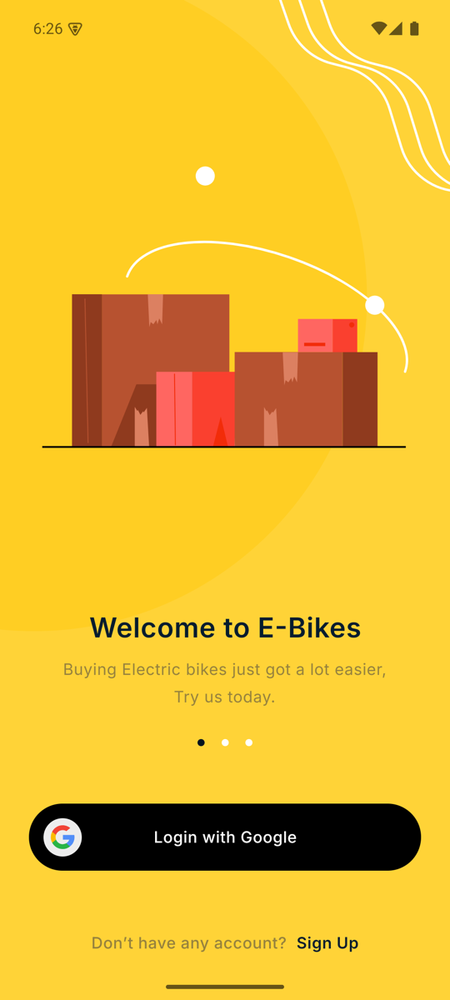
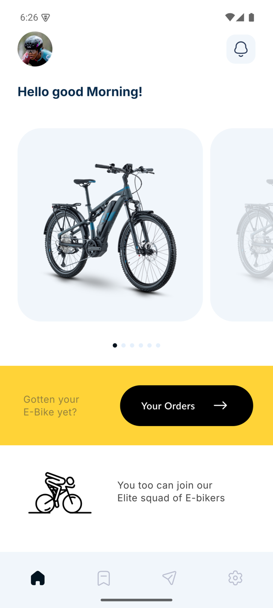
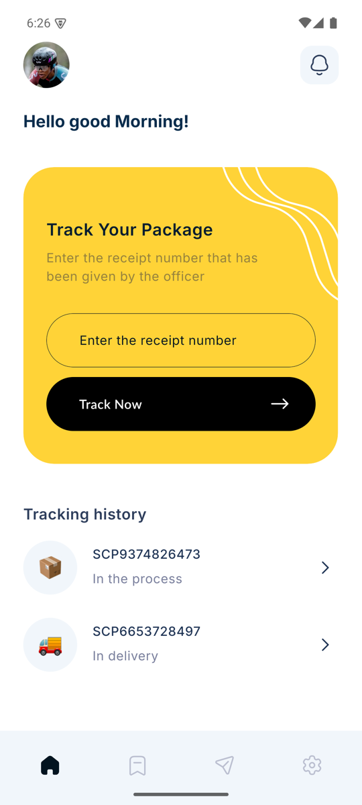
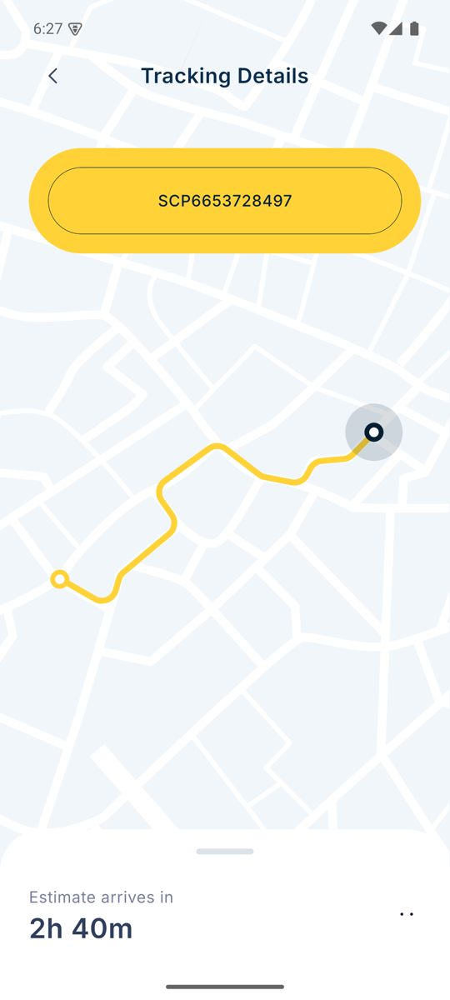
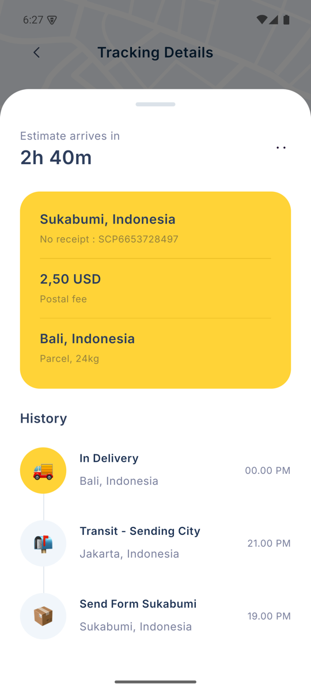

# Breet Delivery App

A React Native implementation of the "TEST | Delivery App" Figma file for Breet's mobile design implementation test. The brief asks for the app to look like the design and nothing more, so it is UI only: buttons navigate, nothing talks to a backend.

## Download

- APK: _link added with the GitHub release_
- Android 7.0 or newer

## Screens

| Login                                | Home                               | Track                                | Tracking Detail                                          | Swipe up                                                   |
| ------------------------------------ | ---------------------------------- | ------------------------------------ | -------------------------------------------------------- | ---------------------------------------------------------- |
|  |  |  |  |  |

What the designer's notes asked for, and where it lives:

- **Use Lottie file**: the cyclist on Home plays LottieFiles #59085, "Bikers Like a Ninja". The Figma layer is named after it, so this is the animation the designer picked.
- **Make the Carousel swipe**: the bike carousel snaps card by card, the next card peeks in faded, and the dots follow the scroll.
- **Your Orders leads here**: Home → Track.
- **Track Now leads to map page**: Track → Tracking Detail. Tapping a history row opens the same screen for that receipt.
- **This swipes Up**: the Tracking Detail sheet drags between the collapsed and expanded frames, with the dimmed backdrop from the design.

## Run it

Needs Node 22.13+, JDK 17 and the Android SDK.

```sh
npm install
npm run android      # builds the dev client and installs it
npm start            # Metro, if the app is already installed
```

Expo Go is not supported: the app uses Reanimated 4, Lottie and a bottom sheet, so it needs a development build.

Checks:

```sh
npm run typecheck
npm run lint
npm run format:check
```

## Build the APK

```sh
eas build -p android --profile preview
```

Or locally, without an Expo account:

```sh
npx expo prebuild -p android --clean
cd android && ./gradlew assembleRelease
```

The local release build is signed with the debug keystore from the template. That is fine for installing a test APK, not for the Play Store.

## How it is put together

```
src/
  App.tsx          providers and navigation container
  navigation/      typed root stack, tab navigator, home stack
  screens/         one folder per screen, with components only that screen uses
  components/      shared primitives: text, buttons, header, dots, tab bar, badge
  theme/           colours, type scale, spacing, radii, sizes (all from Figma)
  hooks/           useDesignInsets
  data/            mock data, copied verbatim from the design
  types/           Product, Shipment, TrackingEvent
  dev/             design overlay (development builds only)
```

## Decisions

- **Expo SDK 58 with prebuild, not bare React Native.** Nothing here needs custom native code, and Expo gets to an installable APK fastest. `android/` is generated, so it is not committed.
- **React Navigation, not Expo Router.** Five screens and one tab bar don't need file-based routing, and typed param lists make every `navigate` call checked by TypeScript.
- **Values come from the Figma file, not from screenshots.** Colours, type styles, letter spacing, radii and positions were read from the file and live in `src/theme`. Screens don't contain raw colours or font names.
- **Layout scales from the 375pt frame width.** `scale()` sizes layout, `moderateScale()` sizes text so it grows more gently on big phones. `useDesignInsets` maps Figma's assumed 44pt status bar and 34pt home indicator onto the real device insets, so the same y-positions work on any Android phone.
- **Fonts are embedded**: Inter, plus Lato 2.0 SemiBold for the "Your Orders" and "Track Now" labels, which is what the design uses there. Both are OFL.
- **Emoji are images.** The design uses Apple emoji; Android would draw Google's instead, so the three emoji ship as PNGs exported from Figma.
- **The map is the vector map from the design**, with the route drawn on top. A live map would need an API key and would never look like the design.
- **The bottom sheet is @gorhom/bottom-sheet.** It already solves dragging into an inner scroll view and velocity snapping. The snap points come from the two Figma frames, the backdrop fades in with the drag, and the map shifts up as the sheet opens, which is what the expanded frame shows.
- **Strings are copied verbatim**, including "Send Form Sukabumi", "No receipt :" and "2,50 USD".
- **The three tabs without designs do nothing when tapped**, and "Sign Up" goes to the same place as "Login with Google", since neither has a screen in the file.
- **Skipped on purpose:** the expanded frame puts a 2px blur on the header behind the dark backdrop. At 50% black it is barely visible, and Android blur is still experimental, so it is left out.

## Credits

- Animation: [Bikers Like a Ninja](https://lottiefiles.com/free-animation/bikers-like-a-ninja-zQwObIGBmM) by Emas Didik Prasetyo, Lottie Simple License.
- Fonts: [Inter](https://rsms.me/inter/) and [Lato](https://www.latofonts.com/), SIL Open Font License (`assets/fonts`).

## With more time

- Real Google sign-in and an API layer behind the mock data.
- Maestro end-to-end tests for the main flow, and component tests for the primitives.
- A proper upload keystore and Play Store build.
- Dark mode, once there is a design for it.
